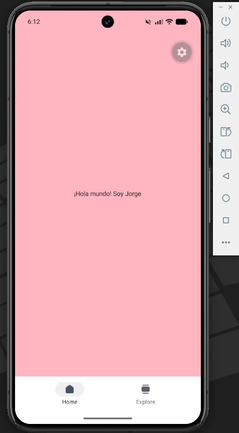

#  Tarea 1:

* **Módulo:** Programación Multimedia y Dispositivos Móviles (PGL - 2º DAM)
* **Unidad:** UT2 - React Native
* **Alumno/a:** [Jorge Hernández Pérez]
* **Fecha:** 12/11/2026

---

## 🎯 1. Objetivo de la tarea
Crear un "hola mundo" con expo para despues usar un emulador de un telefono móvil y asi representar en la pantalla nuestro mensaje

---

## 🛠️ 2. Desarrollo y Pasos Seguidos
Resume brevemente cómo lo has resuelto:

1. **Creación / Configuración:** Creación del proyecto en la terminal con npx
2. **Implementación:** Sustituimos el código del index.tsx para poder representar el mensaje en su pantalla
3. **Pruebas:** Ejecución en emulador Android / dispositivo físico con Expo Go, logeandonos en expo y configurándolo.

---

## 💻 3. Código Implementado

```jsx
import { StyleSheet, Text, View } from 'react-native';

export default function Index() {
  return (
    <View style={styles.pantalla}>
      <Text>¡Hola mundo! Soy Jorge</Text>
    </View>
  );
}

const styles = StyleSheet.create({
  pantalla: {
    alignItems: 'center',
    backgroundColor: 'lightpink',
    flex: 1,
    justifyContent: 'center',
  },
});
```

---

## 📸 4. Resultado (Capturas de pantalla)



---
