#  Dossier react-native:


* **Módulo:** Programación Multimedia y Dispositivos Móviles (PGL - 2º DAM)
* **Unidad:** UT2 - React Native
* **Alumno/a:** [Jorge Hernández Pérez]
* **Fecha:** 12/11/2026

---

#  Tarea 1:

## 🎯 1. Objetivo de la tarea
Crear un "hola mundo" con expo para despues usar un emulador de un telefono móvil y asi representar en la pantalla nuestro mensaje

---

## 🛠️ 2. Desarrollo y Pasos Seguidos

1. **Creación / Configuración:** Creación del proyecto en la terminal con npx
2. **Implementación:** Sustituimos el código del index.tsx para poder representar el mensaje en su pantalla
3. **Pruebas:** Ejecución en emulador Android / dispositivo físico con Expo Go, logeandonos en expo y configurándolo.

---

## 💻 3. Código Implementado

```jsx
import { StyleSheet, Text, View } from 'react-native';

export default function Index() {
  return (
    <View style={styles.pantalla}>
      <Text>¡Hola mundo! Soy Jorge</Text>
    </View>
  );
}

const styles = StyleSheet.create({
  pantalla: {
    alignItems: 'center',
    backgroundColor: 'lightpink',
    flex: 1,
    justifyContent: 'center',
  },
});
```

---

## 📸 4. Resultado (Capturas de pantalla)


---


#  Tarea 2:


## 🎯 1. Objetivo de la tarea
Creación de dos botones, uno que incremente y otro que descremente, además de cambiar el estilo de los botones y de algunos elementos.

---

## 🛠️ 2. Desarrollo y Pasos Seguidos

1. **Edición:** Edición de la pantalla principal de la aplciación para que muestre lo que deseemos.
2. **Implementación:** Implementamos funciones que hagan las funciones que buscamos para completar la actividad.
3. **Pruebas:** Ejecución en emulador Android

---

## 💻 3. Código Implementado

```jsx
import { useState } from 'react';
import { Button, StyleSheet, Text, View } from 'react-native';

export default function ContadorScreen() {
  const [contador, setContador] = useState(0);

  return (
    <View style={styles.contenedorPrincipal}>
      <View style={styles.caja}>
        <Text style={styles.texto}>Contador: {contador}</Text>
        
        <View style={styles.filaBotones}>
          <Button 
            title="Decrementar" 
            color="#d9534f"
            onPress={() => setContador(n => n - 1)} 
          />
          <Button 
            title="Incrementar" 
            color="#5cb85c"
            onPress={() => setContador(n => n + 1)} 
          />
        </View>
      </View>
    </View>
  );
}

const styles = StyleSheet.create({
  contenedorPrincipal: {
    flex: 1,
    justifyContent: 'center',
    alignItems: 'center',
    backgroundColor: '#f5f5f5',
  },
  caja: {
    alignItems: 'center',
    backgroundColor: '#e3f2fd', 
    borderColor: '#1976d2',    
    borderWidth: 2,
    borderRadius: 15,         
    padding: 25,
    gap: 15,
  },
  texto: {
    fontSize: 22,
    fontWeight: 'bold',
  },
  filaBotones: {
    flexDirection: 'row',      
    gap: 12,                   
  },
});


```
---

## 📸 4. Resultado (Capturas de pantalla)

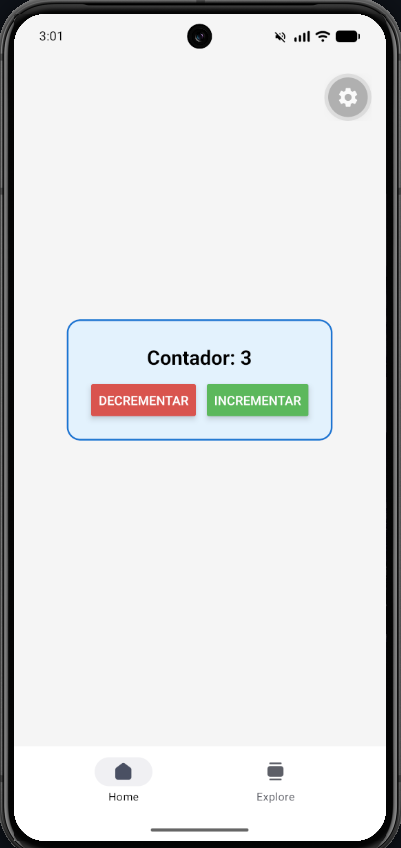

---

#  Tarea 3:


## 🎯 1. Objetivo de la tarea
Separar las últimas dos actividades en pantallas diferentes dentro de la carpeta src/screens

---

## 🛠️ 2. Desarrollo y Pasos Seguidos

1. **Creación / Configuración:** Creación de la carpeta screens dentro de src, y de los archivos HolaMundo.tsx e InicioScreen.tsx.
2. **Implementación:**Implementamos el código de cada pantalla dentro de su respectivo archivo

---


## 📸 3. Resultado (Capturas de pantalla)


---

#  Tarea 4:


## 🎯 1. Objetivo de la tarea
Comprender el funcionamiento básico de Flexbox en React Native y aprender a crear componentes reutilizables.

---

## 🛠️ 2. Desarrollo y Pasos Seguidos

1. **Creación :** Creación del componente caja.tsx para no tener que repetir código, además de la pantalla PincipalScreen.tsx
2. **Implementación:** Creamos el código para ambos arvhivos y dentro de index.tsx actualizamos para que se vea la patalla nueva.
3. **Pruebas:** Ejecución en emulador Android
---

## 💻 3. Código Implementado


```jsx
import { StyleSheet, Text, View } from 'react-native';
import Caja from '../components/Caja';

export default function PrincipalScreen() {
  return (
    <View style={styles.contenedor}>
      <Text style={styles.titulo}>Contenedor Principal</Text>
      
      <View style={styles.escenario}>
        <Caja nombre="Caja 1" bg="#e53935" />
        <Caja nombre="Caja 2" bg="#1e88e5" />
        <Caja nombre="Caja 3" bg="#43a047" />
      </View>
    </View>
  );
}

const styles = StyleSheet.create({
  contenedor: {
    flex: 1,
    paddingTop: 50,
    backgroundColor: '#f5f5f5',
  },
  titulo: {
    fontSize: 22,
    fontWeight: 'bold',
    textAlign: 'center',
    marginBottom: 20,
  },
  escenario: {
    flex: 1,
    justifyContent: 'space-around', 
    alignItems: 'center',          
    backgroundColor: '#e0e0e0',
    margin: 16,
    borderRadius: 12,
  },
});

```

```jsx
import { StyleSheet, Text, View } from 'react-native';

type Props = { 
  nombre: string; 
  bg?: string; 
};

export default function Caja({ nombre, bg = 'green' }: Props) {
  return (
    <View style={[styles.caja, { backgroundColor: bg }]}>
      <Text style={styles.texto}>{nombre}</Text>
    </View>
  );
}

const styles = StyleSheet.create({
  caja: { 
    height: 100, 
    width: 100, 
    justifyContent: 'center', 
    alignItems: 'center',
    borderRadius: 8,
  },
  texto: {
    color: 'white',
    fontWeight: 'bold',
  },
});

```

---

## 📸 4. Resultado (Capturas de pantalla)


---

#  Tarea 5:


## 🎯 1. Objetivo de la tarea
El objetivo de esta actividad es comprender cómo la propiedad flex reparte dinámicamente el espacio disponible entre elementos hermanos dentro de un contenedor en React Native.

---

## 🛠️ 2. Desarrollo y Pasos Seguidos

1. **Creación:** Creación del nuevo componente `CajaFlex.tsx` (una variante sin altura fija para que `flex` pueda actuar libremente) y de la pantalla `Practica5Screen.tsx` para mantener el ejercicio independiente y consultable.
2. **Implementación:** Programamos la lógica de estado individual (`useState`) con los botones para incrementar y decrementar `valorFlex` (limitado a un mínimo de `0` con `Math.max`), montamos las tres cajas en `Practica5Screen.tsx` y actualizamos `index.tsx` para mostrar esta pantalla.
3. **Pruebas:** Ejecución en el emulador de Android Studio comprobando cómo se reorganiza y reparte proporcionalmente el espacio entre las tres cajas al pulsar los botones.

---

## 💻 3. Código Implementado


```jsx
import { StyleSheet, Text, View } from 'react-native';
import CajaFlex from '../components/CajaFlex';

export default function Practica5Screen() {
  return (
    <View style={styles.contenedor}>
      <Text style={styles.titulo}>Práctica 5: Reparto con Flex</Text>

      <View style={styles.escenario}>
        <CajaFlex nombre="Caja 1" bg="#e53935" />
        <CajaFlex nombre="Caja 2" bg="#1e88e5" />
        <CajaFlex nombre="Caja 3" bg="#43a047" />
      </View>
    </View>
  );
}

const styles = StyleSheet.create({
  contenedor: {
    flex: 1,
    paddingTop: 50,
    backgroundColor: '#f5f5f5',
  },
  titulo: {
    fontSize: 22,
    fontWeight: 'bold',
    textAlign: 'center',
    marginBottom: 15,
  },
  escenario: {
    flex: 1,
    alignItems: 'center',
    backgroundColor: '#e0e0e0',
    margin: 16,
    padding: 10,
    borderRadius: 12,
  },
});


```

```jsx
import { useState } from 'react';
import { Button, StyleSheet, Text, View } from 'react-native';

type Props = {
  nombre: string;
  bg?: string;
};

export default function CajaFlex({ nombre, bg = '#43a047' }: Props) {
  const [valorFlex, setValorFlex] = useState(1);

  return (
    <View style={[styles.caja, { backgroundColor: bg, flex: valorFlex }]}>
      <Text style={styles.texto}>
        {nombre} — flex: {valorFlex}
      </Text>

      <View style={styles.filaBotones}>
        <Button
          title="-"
          color="#212121"
          onPress={() => setValorFlex(n => Math.max(0, n - 1))}
        />
        <Button
          title="+"
          color="#212121"
          onPress={() => setValorFlex(n => n + 1)}
        />
      </View>
    </View>
  );
}

const styles = StyleSheet.create({
  caja: {
    width: '90%',
    minHeight: 70,
    justifyContent: 'center',
    alignItems: 'center',
    borderRadius: 10,
    padding: 8,
    marginVertical: 4,
  },
  texto: {
    color: 'white',
    fontWeight: 'bold',
    fontSize: 16,
    marginBottom: 6,
  },
  filaBotones: {
    flexDirection: 'row',
    gap: 15,
  },
});


```

---

## 📸 4. Resultado (Capturas de pantalla)

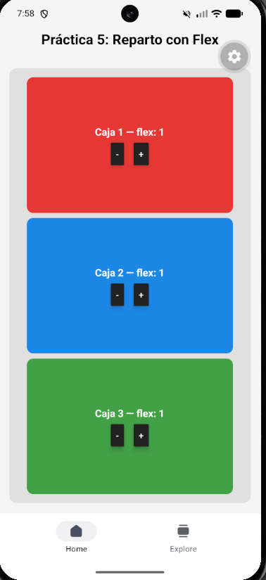

---

#  Tarea 6:


## 🎯 1. Objetivo de la tarea
El objetivo de esta actividad es comprender las diferencias entre los componentes táctiles TouchableOpacity y TouchableHighlight en React Native frente a los botones nativos tradicionales

---
## 🛠️ 2. Desarrollo y Pasos Seguidos

1. **Creación:** Creación del nuevo componente `CajaTouchable.tsx` (sustituyendo los botones nativos por contenedores táctiles personalizados) y de la pantalla `Practica6Screen.tsx` para conservar las prácticas anteriores consultables.
2. **Implementación:** Programamos el botón de decremento con `TouchableOpacity` (reduciendo su opacidad al pulsar) y el de incremento con `TouchableHighlight` (aplicando `underlayColor` y disparando una ventana emergente con `Alert.alert`), montamos las tres cajas en `Practica6Screen.tsx` y actualizamos `index.tsx` para mostrar esta pantalla.
3. **Pruebas:** Ejecución en el emulador de Android Studio verificando el efecto visual de cada componente táctil, el lanzamiento de la alerta al sumar y el reparto proporcional de espacio en pantalla.

---

## 💻 3. Código Implementado


```jsx

import { StyleSheet, Text, View } from 'react-native';
import CajaTouchable from '../components/CajaTouchable';

export default function Practica6Screen() {
  return (
    <View style={styles.contenedor}>
      <Text style={styles.titulo}>Práctica 6: Componentes Táctiles</Text>

      <View style={styles.escenario}>
        <CajaTouchable nombre="Caja 1" bg="#e53935" />
        <CajaTouchable nombre="Caja 2" bg="#1e88e5" />
        <CajaTouchable nombre="Caja 3" bg="#43a047" />
      </View>
    </View>
  );
}

const styles = StyleSheet.create({
  contenedor: {
    flex: 1,
    paddingTop: 50,
    backgroundColor: '#f5f5f5',
  },
  titulo: {
    fontSize: 22,
    fontWeight: 'bold',
    textAlign: 'center',
    marginBottom: 15,
  },
  escenario: {
    flex: 1,
    alignItems: 'center',
    backgroundColor: '#e0e0e0',
    margin: 16,
    padding: 10,
    borderRadius: 12,
  },
});


```

```jsx

import { useState } from 'react';
import { Alert, StyleSheet, Text, TouchableHighlight, TouchableOpacity, View } from 'react-native';

type Props = {
  nombre: string;
  bg?: string;
};

export default function CajaTouchable({ nombre, bg = '#43a047' }: Props) {
  const [valorFlex, setValorFlex] = useState(1);

  const manejarIncremento = () => {
    setValorFlex(n => n + 1);
    Alert.alert('Flex aumentado', `${nombre} ahora tiene flex: ${valorFlex + 1}`);
  };

  return (
    <View style={[styles.caja, { backgroundColor: bg, flex: valorFlex }]}>
      <Text style={styles.texto}>
        {nombre} — flex: {valorFlex}
      </Text>

      <View style={styles.filaBotones}>
        <TouchableOpacity
          style={styles.botonRestar}
          activeOpacity={0.6}
          onPress={() => setValorFlex(n => Math.max(0, n - 1))}
        >
          <Text style={styles.textoBoton}>-1 Flex</Text>
        </TouchableOpacity>

        <TouchableHighlight
          style={styles.botonSumar}
          underlayColor="#1b5e20"
          onPress={manejarIncremento}
        >
          <Text style={styles.textoBoton}>+1 Flex</Text>
        </TouchableHighlight>
      </View>
    </View>
  );
}

const styles = StyleSheet.create({
  caja: {
    width: '90%',
    minHeight: 80,
    justifyContent: 'center',
    alignItems: 'center',
    borderRadius: 12,
    padding: 10,
    marginVertical: 4,
  },
  texto: {
    color: 'white',
    fontWeight: 'bold',
    fontSize: 16,
    marginBottom: 8,
  },
  filaBotones: {
    flexDirection: 'row',
    gap: 15,
  },
  botonRestar: {
    backgroundColor: '#212121',
    paddingVertical: 8,
    paddingHorizontal: 16,
    borderRadius: 20,
    borderWidth: 1,
    borderColor: 'white',
  },
  botonSumar: {
    backgroundColor: '#004d40',
    paddingVertical: 8,
    paddingHorizontal: 16,
    borderRadius: 20,
    borderWidth: 1,
    borderColor: 'white',
  },
  textoBoton: {
    color: 'white',
    fontWeight: 'bold',
    fontSize: 14,
  },
});


```

---

## 📸 4. Resultado (Capturas de pantalla)

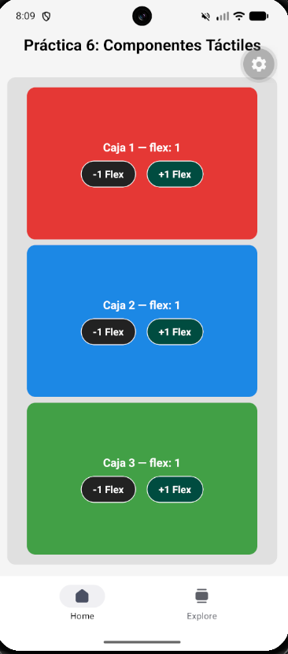

---

#  Tarea 7:


## 🎯 1. Objetivo de la tarea
El objetivo de esta actividad es aprender a personalizar la apariencia de componentes reutilizables en React Native mediante el envío de estilos como propiedades (Props), utilizando el tipado StyleProp<ViewStyle> de TypeScript

---

## 🛠️ 2. Desarrollo y Pasos Seguidos

1. **Creación:** Creación del nuevo componente `CajaEstilo.tsx` preparado para recibir estilos externos mediante la propiedad tipada `style?: StyleProp<ViewStyle>`, junto con la pantalla `Practica7Screen.tsx`.
2. **Implementación:** Combinamos los estilos por defecto con los recibidos mediante el array `[styles.porDefecto, style]`, instanciamos en `Practica7Screen.tsx` las tres cajas (`Caja A`, `Caja B` con esquinas redondeadas y borde grueso, y `Caja C` personalizada) y actualizamos `index.tsx` para visualizarla.
3. **Pruebas:** Ejecución en el emulador de Android Studio verificando que cada caja aplica correctamente sus estilos personalizados sobrescribiendo los valores base sin duplicar código.

---

## 💻 3. Código Implementado

```jsx
import { StyleSheet, Text, View } from 'react-native';
import CajaEstilo from '../components/CajaEstilo';

export default function Practica7Screen() {
  return (
    <View style={styles.contenedor}>
      <Text style={styles.titulo}>Práctica 7: Estilos por Props</Text>

      <View style={styles.escenario}>
        {/* Caja A: conserva el estilo por defecto */}
        <CajaEstilo nombre="Caja A" />

        {/* Caja B: esquinas redondeadas y borde diferente */}
        <CajaEstilo
          nombre="Caja B"
          style={{
            backgroundColor: '#e53935',
            borderRadius: 20,
            borderWidth: 7,
            borderColor: '#ffcdd2',
          }}
        />

        {/* Caja C: otro estilo personalizado */}
        <CajaEstilo
          nombre="Caja C"
          style={{
            backgroundColor: '#43a047',
            borderRadius: 50,
            borderWidth: 4,
            borderColor: '#1b5e20',
            width: 200,
          }}
        />
      </View>
    </View>
  );
}

const styles = StyleSheet.create({
  contenedor: {
    flex: 1,
    paddingTop: 50,
    backgroundColor: '#f5f5f5',
  },
  titulo: {
    fontSize: 22,
    fontWeight: 'bold',
    textAlign: 'center',
    marginBottom: 15,
  },
  escenario: {
    flex: 1,
    justifyContent: 'space-around',
    alignItems: 'center',
    backgroundColor: '#e0e0e0',
    margin: 16,
    padding: 15,
    borderRadius: 12,
  },
});


```

```jsx
import type { StyleProp, ViewStyle } from 'react-native';
import { StyleSheet, Text, View } from 'react-native';

type Props = {
  nombre: string;
  style?: StyleProp<ViewStyle>;
};

export default function CajaEstilo({ nombre, style }: Props) {
  return (
    <View style={[styles.porDefecto, style]}>
      <Text style={styles.texto}>{nombre}</Text>
    </View>
  );
}

const styles = StyleSheet.create({
  porDefecto: {
    height: 110,
    width: 150,
    backgroundColor: '#1976d2',
    justifyContent: 'center',
    alignItems: 'center',
    borderWidth: 2,
    borderColor: '#0d47a1',
  },
  texto: {
    color: 'white',
    fontWeight: 'bold',
    fontSize: 18,
  },
});


```
---

## 📸 4. Resultado (Capturas de pantalla)

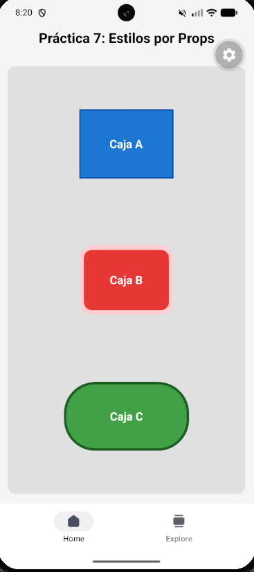

---
# Tarea 8:

## 🎯 1. Objetivo de la tarea
El objetivo de esta actividad es comprender el funcionamiento de las propiedades `flexDirection` y `flexWrap` de Flexbox para controlar la dirección y el desbordamiento de elementos dinámicos en React Native.
---

## 🛠️ 2. Desarrollo y Pasos Seguidos

1. **Creación:** Creación de la pantalla `Practica8Screen.tsx` partiendo de un escenario vacío y preparando los estados necesarios para almacenar los colores de los círculos (`colores`), la dirección (`row` / `column`) y el ajuste de línea (`wrap` / `nowrap`).
2. **Implementación:** Programamos tres botones personalizados con `TouchableOpacity` para añadir círculos de color variable (asegurando con `Math.min(255, valor)` que los tonos RGB no superen el límite) y alternar las propiedades Flexbox en tiempo real, actualizando `index.tsx` para mostrar la pantalla.
3. **Pruebas:** Ejecución en el emulador de Android Studio añadiendo múltiples círculos y comprobando cómo se reorganizan o saltan de fila y columna al alternar entre `row`, `column`, `wrap` y `nowrap`.

---

## 💻 3. Código Implementado

```jsx
import { useState } from 'react';
import { StyleSheet, Text, TouchableOpacity, View } from 'react-native';

export default function Practica8Screen() {
  const [colores, setColores] = useState<string[]>([]);
  const [direccion, setDireccion] = useState<'row' | 'column'>('row');
  const [envoltura, setEnvoltura] = useState<'wrap' | 'nowrap'>('wrap');

  const anadirCirculo = () => {
    const indice = colores.length;
    // Calculamos valores RGB progresivos y limitados a 255
    const r = Math.min(255, (indice * 35) % 260);
    const g = Math.min(255, 80 + ((indice * 25) % 180));
    const b = Math.min(255, 220 - ((indice * 20) % 200));

    const nuevoColor = `rgb(${r}, ${g}, ${b})`;
    setColores(prev => [...prev, nuevoColor]);
  };

  const alternarDireccion = () => {
    setDireccion(prev => (prev === 'row' ? 'column' : 'row'));
  };

  const alternarEnvoltura = () => {
    setEnvoltura(prev => (prev === 'wrap' ? 'nowrap' : 'wrap'));
  };

  return (
    <View style={styles.contenedor}>
      <Text style={styles.titulo}>Práctica 8: Círculos Dinámicos</Text>

      <View style={styles.panelControles}>
        <TouchableOpacity style={styles.botonAnadir} onPress={anadirCirculo}>
          <Text style={styles.textoBoton}>+ Círculo</Text>
        </TouchableOpacity>

        <TouchableOpacity style={styles.botonControl} onPress={alternarDireccion}>
          <Text style={styles.textoBoton}>Dir: {direccion}</Text>
        </TouchableOpacity>

        <TouchableOpacity style={styles.botonControl} onPress={alternarEnvoltura}>
          <Text style={styles.textoBoton}>Wrap: {envoltura}</Text>
        </TouchableOpacity>
      </View>

      <View
        style={[
          styles.escenario,
          { flexDirection: direccion, flexWrap: envoltura },
        ]}
      >
        {colores.map((color, index) => (
          <View
            key={index}
            style={[styles.circulo, { backgroundColor: color }]}
          />
        ))}
      </View>
    </View>
  );
}

const styles = StyleSheet.create({
  contenedor: {
    flex: 1,
    paddingTop: 50,
    backgroundColor: '#f5f5f5',
  },
  titulo: {
    fontSize: 22,
    fontWeight: 'bold',
    textAlign: 'center',
    marginBottom: 15,
  },
  panelControles: {
    flexDirection: 'row',
    justifyContent: 'center',
    gap: 10,
    paddingHorizontal: 12,
    marginBottom: 12,
  },
  botonAnadir: {
    backgroundColor: '#2e7d32',
    paddingVertical: 10,
    paddingHorizontal: 14,
    borderRadius: 20,
  },
  botonControl: {
    backgroundColor: '#1565c0',
    paddingVertical: 10,
    paddingHorizontal: 14,
    borderRadius: 20,
  },
  textoBoton: {
    color: 'white',
    fontWeight: 'bold',
    fontSize: 13,
  },
  escenario: {
    flex: 1,
    backgroundColor: '#e0e0e0',
    margin: 16,
    padding: 12,
    borderRadius: 12,
    gap: 8,
  },
  circulo: {
    width: 60,
    height: 60,
    borderRadius: 30,
  },
});


```
---

## 📸 4. Resultado (Capturas de pantalla)

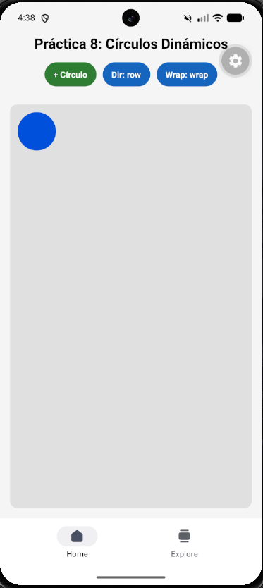

---

# Tarea 9:

## 🎯 1. Objetivo de la tarea
El objetivo de esta actividad es aprender a controlar la distribución y alineación de elementos mediante las propiedades `justifyContent` y `alignItems` de Flexbox, combinadas con entradas de texto controladas (`TextInput`) validadas con tipos unión en TypeScript y la carga de imágenes locales (`require`) y remotas (`uri`) con el componente `Image`.

---

## 🛠️ 2. Desarrollo y Pasos Seguidos

1. **Creación:** Creación de la pantalla `Practica9Screen.tsx` definiendo tipos unión en TypeScript (`JustifyValido` y `AlignValido`) para garantizar que solo se apliquen valores admitidos por los estilos de Flexbox.
2. **Implementación:** Programamos un campo `TextInput` controlado que valida en tiempo real el valor escrito para `justifyContent`, una fila de botones personalizados para alternar `alignItems`, un indicador de las alineaciones activas y un escenario con `flexWrap: 'nowrap'` que contiene tres componentes `Image` (una imagen local con `require` y dos remotas mediante `uri`), actualizando `index.tsx` para mostrar la pantalla.
3. **Pruebas:** Ejecución en el emulador de Android Studio comprobando que las tres imágenes se cargan correctamente y se redistribuyen sobre ambos ejes al escribir valores válidos en el campo de texto o pulsar los botones de alineación.


---

## 💻 3. Código Implementado

```jsx
import { useState } from 'react';
import {
    Image,
    StyleSheet,
    Text,
    TextInput,
    TouchableOpacity,
    View,
} from 'react-native';

type JustifyValido =
  | 'flex-start'
  | 'flex-end'
  | 'center'
  | 'space-between'
  | 'space-around'
  | 'space-evenly';

type AlignValido = 'flex-start' | 'center' | 'flex-end' | 'stretch';

const VALORES_JUSTIFY: JustifyValido[] = [
  'flex-start',
  'flex-end',
  'center',
  'space-between',
  'space-around',
  'space-evenly',
];

const VALORES_ALIGN: AlignValido[] = [
  'flex-start',
  'center',
  'flex-end',
  'stretch',
];

export default function Practica9Screen() {
  const [textoInput, setTextoInput] = useState('center');
  const [justifyActivo, setJustifyActivo] = useState<JustifyValido>('center');
  const [alignActivo, setAlignActivo] = useState<AlignValido>('center');

  const manejarCambioTexto = (texto: string) => {
    setTextoInput(texto);
    const limpio = texto.trim().toLowerCase() as JustifyValido;

    if (VALORES_JUSTIFY.includes(limpio)) {
      setJustifyActivo(limpio);
    }
  };

  return (
    <View style={styles.contenedor}>
      <Text style={styles.titulo}>Práctica 9: Alineación e Imágenes</Text>

      {/* Panel de controles */}
      <View style={styles.panelControles}>
        <Text style={styles.etiqueta}>
          justifyContent (center, space-around, space-between, flex-start, flex-end):
        </Text>
        <TextInput
          style={styles.input}
          placeholder="Escribe un valor válido..."
          value={textoInput}
          onChangeText={manejarCambioTexto}
          autoCapitalize="none"
          autoCorrect={false}
        />

        <Text style={styles.etiqueta}>alignItems:</Text>
        <View style={styles.filaBotones}>
          {VALORES_ALIGN.map(opcion => (
            <TouchableOpacity
              key={opcion}
              style={[
                styles.boton,
                alignActivo === opcion && styles.botonActivo,
              ]}
              onPress={() => setAlignActivo(opcion)}
            >
              <Text style={styles.textoBoton}>{opcion}</Text>
            </TouchableOpacity>
          ))}
        </View>

        <Text style={styles.estadoActivo}>
          Activos → justifyContent: "{justifyActivo}" | alignItems: "{alignActivo}"
        </Text>
      </View>

      <View
        style={[
          styles.escenario,
          {
            justifyContent: justifyActivo,
            alignItems: alignActivo,
          },
        ]}
      >
                <Image
          source={require('../../assets/images/icon.png')}
          style={styles.imagen}
          resizeMode="contain"
        />

        <Image
          source={{ uri: 'https://reactnative.dev/img/tiny_logo.png' }}
          style={styles.imagen}
          resizeMode="contain"
        />

        <Image
          source={{ uri: 'https://githubusercontent.com' }}
          style={styles.imagen}
          resizeMode="contain"
        />
      </View>
    </View>
  );
}

const styles = StyleSheet.create({
  contenedor: {
    flex: 1,
    paddingTop: 45,
    backgroundColor: '#f5f5f5',
  },
  titulo: {
    fontSize: 20,
    fontWeight: 'bold',
    textAlign: 'center',
    marginBottom: 10,
  },
  panelControles: {
    paddingHorizontal: 16,
    gap: 8,
  },
  etiqueta: {
    fontSize: 13,
    fontWeight: '600',
    color: '#333',
  },
  input: {
    backgroundColor: 'white',
    borderWidth: 1,
    borderColor: '#bbb',
    borderRadius: 8,
    paddingHorizontal: 12,
    paddingVertical: 8,
    fontSize: 15,
  },
  filaBotones: {
    flexDirection: 'row',
    flexWrap: 'wrap',
    gap: 6,
  },
  boton: {
    backgroundColor: '#546e7a',
    paddingVertical: 7,
    paddingHorizontal: 10,
    borderRadius: 16,
  },
  botonActivo: {
    backgroundColor: '#1565c0',
  },
  textoBoton: {
    color: 'white',
    fontSize: 12,
    fontWeight: 'bold',
  },
  estadoActivo: {
    fontSize: 12,
    fontWeight: 'bold',
    color: '#1565c0',
    marginTop: 4,
    textAlign: 'center',
  },
  escenario: {
    flex: 1,
    flexDirection: 'column',
    flexWrap: 'nowrap',
    backgroundColor: '#e0e0e0',
    margin: 16,
    padding: 12,
    borderRadius: 12,
    borderWidth: 2,
    borderColor: '#bdbdbd',
  },
  imagen: {
    width: 70,
    height: 70,
    borderRadius: 10,
  },
});


```
---

## 📸 4. Resultado (Capturas de pantalla)

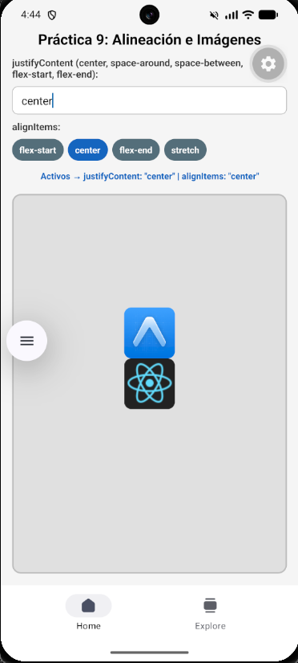

---

# Tarea 9.1:

## 🎯 1. Objetivo de la tarea
El objetivo de esta actividad es aprender a seleccionar y mostrar imágenes locales de forma dinámica mediante una colección estática de llamadas a `require`, gestionando la posición activa con `useState` y selección aleatoria con `Math.random()`.

---

## 🛠️ 2. Desarrollo y Pasos Seguidos

1. **Creación:** Creación de la pantalla `Practica9-1Screen.tsx` utilizando `SafeAreaView` de `react-native-safe-area-context` como contenedor principal y preparando un array previo de objetos con rutas estáticas mediante `require`.
2. **Implementación:** Programamos un estado `indice` con `useState` y un botón personalizado (`TouchableOpacity`) que calcula una posición aleatoria mediante `Math.floor(Math.random() * imagenes.length)` para actualizar la imagen y su nombre en pantalla, conectando después la vista en `index.tsx`.
3. **Pruebas:** Ejecución en el emulador de Android Studio comprobando que la interfaz respeta los márgenes superiores del dispositivo y que al pulsar el botón se alternan aleatoriamente las distintas imágenes locales.
4. 
---

## 💻 3. Código Implementado

```jsx

import { useState } from 'react';
import { Image, StyleSheet, Text, TouchableOpacity, View } from 'react-native';
import { SafeAreaView } from 'react-native-safe-area-context';

// Lista previa con llamadas estáticas a require (ajusta los nombres a los archivos reales de tu carpeta assets)
const imagenes = [
  { nombre: 'Icono App', source: require('../../assets/images/icon.png') },
  { nombre: 'React Logo', source: require('../../assets/images/react-logo.png') },
  { nombre: 'Splash Icon', source: require('../../assets/images/splash-icon.png') },
];

export default function Practica9_1Screen() {
  const [indice, setIndice] = useState(0);

  const elegirAleatoria = () => {
    const nuevoIndice = Math.floor(Math.random() * imagenes.length);
    setIndice(nuevoIndice);
  };

  const elegida = imagenes[indice];

  return (
    <SafeAreaView style={styles.contenedor}>
      <Text style={styles.titulo}>Práctica 9.1: Imagen Aleatoria</Text>

      <View style={styles.escenario}>
        <Image
          source={elegida.source}
          style={styles.imagen}
          resizeMode="contain"
        />
        <Text style={styles.nombreImagen}>
          Mostrando: {elegida.nombre} (Índice: {indice})
        </Text>

        <TouchableOpacity style={styles.boton} onPress={elegirAleatoria}>
          <Text style={styles.textoBoton}>Elegir imagen aleatoria</Text>
        </TouchableOpacity>
      </View>
    </SafeAreaView>
  );
}

const styles = StyleSheet.create({
  contenedor: {
    flex: 1,
    backgroundColor: '#f5f5f5',
  },
  titulo: {
    fontSize: 22,
    fontWeight: 'bold',
    textAlign: 'center',
    marginTop: 15,
    marginBottom: 15,
  },
  escenario: {
    flex: 1,
    justifyContent: 'center',
    alignItems: 'center',
    backgroundColor: '#e0e0e0',
    margin: 16,
    borderRadius: 12,
    padding: 20,
    gap: 20,
  },
  imagen: {
    width: 150,
    height: 150,
    borderRadius: 12,
  },
  nombreImagen: {
    fontSize: 16,
    fontWeight: 'bold',
    color: '#333',
  },
  boton: {
    backgroundColor: '#1565c0',
    paddingVertical: 12,
    paddingHorizontal: 24,
    borderRadius: 25,
  },
  textoBoton: {
    color: 'white',
    fontWeight: 'bold',
    fontSize: 16,
  },
});


```
---

## 📸 4. Resultado (Capturas de pantalla)

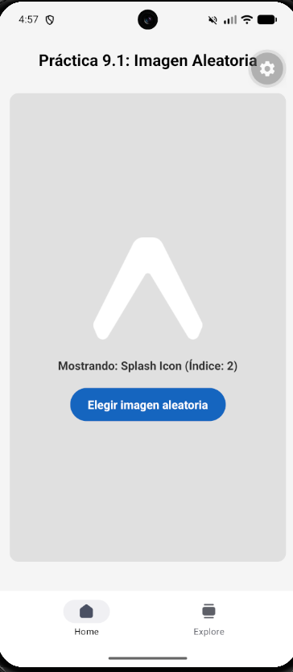

---

# Tarea 10:

## 🎯 1. Objetivo de la tarea
El objetivo de esta actividad es construir una calculadora funcional en React Native aplicando propiedades avanzadas de layout con Flexbox (`gap` y filas horizontales), componentes reutilizables creados con `TouchableOpacity` y adaptación automática de texto mediante `numberOfLines` y `adjustsFontSizeToFit`.

---

## 🛠️ 2. Desarrollo y Pasos Seguidos

1. **Creación:** Creación del componente reutilizable `TeclaCalculadora.tsx` (basado en `TouchableOpacity` y configurable mediante propiedades de color, etiqueta y ancho doble) y de la pantalla `CalculadoraScreen.tsx` protegida con `SafeAreaView`.
2. **Implementación:** Programamos la lógica de cálculo mediante estados independientes (`actual`, `anterior` y `operacion`) utilizando un bloque `switch` seguro para resolver sumas, restas, multiplicaciones y divisiones, configurando el visor con `numberOfLines={1}` y `adjustsFontSizeToFit` y actualizando `index.tsx` para mostrar la aplicación.
3. **Pruebas:** Ejecución en el emulador de Android Studio comprobando las operaciones básicas, el borrado de dígitos, el control de división entre cero y el ajuste automático del tamaño de fuente al introducir números largos.

## 💻 3. Código Implementado

```jsx
import { useState } from 'react';
import { StyleSheet, Text, View } from 'react-native';
import { SafeAreaView } from 'react-native-safe-area-context';
import TeclaCalculadora from '../components/TeclaCalculadora';

type Operacion = '+' | '-' | '×' | '÷' | null;

export default function CalculadoraScreen() {
  const [actual, setActual] = useState('0');
  const [anterior, setAnterior] = useState<string | null>(null);
  const [operacion, setOperacion] = useState<Operacion>(null);
  const [reiniciarVisor, setReiniciarVisor] = useState(false);

  const pulsarNumero = (num: string) => {
    if (reiniciarVisor) {
      setActual(num);
      setReiniciarVisor(false);
      return;
    }

    if (num === '.' && actual.includes('.')) return;

    if (actual === '0' && num !== '.') {
      setActual(num);
    } else {
      setActual(actual + num);
    }
  };

  const limpiar = () => {
    setActual('0');
    setAnterior(null);
    setOperacion(null);
    setReiniciarVisor(false);
  };

  const borrarUltimo = () => {
    if (reiniciarVisor) return;
    if (actual.length === 1 || (actual.length === 2 && actual.startsWith('-'))) {
      setActual('0');
    } else {
      setActual(actual.slice(0, -1));
    }
  };

  const cambiarSigno = () => {
    if (actual === '0') return;
    setActual(actual.startsWith('-') ? actual.slice(1) : '-' + actual);
  };

  const calcularResultado = (a: number, b: number, op: Operacion): string => {
    switch (op) {
      case '+':
        return String(a + b);
      case '-':
        return String(a - b);
      case '×':
        return String(a * b);
      case '÷':
        return b === 0 ? 'Error' : String(Number((a / b).toFixed(6)));
      default:
        return String(b);
    }
  };

  const seleccionarOperacion = (op: Operacion) => {
    if (anterior !== null && operacion && !reiniciarVisor) {
      const resultado = calcularResultado(Number(anterior), Number(actual), operacion);
      setActual(resultado);
      setAnterior(resultado === 'Error' ? null : resultado);
    } else {
      setAnterior(actual);
    }
    setOperacion(op);
    setReiniciarVisor(true);
  };

  const pulsarIgual = () => {
    if (anterior === null || !operacion) return;
    const resultado = calcularResultado(Number(anterior), Number(actual), operacion);
    setActual(resultado);
    setAnterior(null);
    setOperacion(null);
    setReiniciarVisor(true);
  };

  return (
    <SafeAreaView style={styles.contenedor}>
      {/* Visor de resultados */}
      <View style={styles.visor}>
        <Text style={styles.subtitulo}>
          {anterior !== null && operacion ? `${anterior} ${operacion}` : ''}
        </Text>
        <Text
          style={styles.resultado}
          numberOfLines={1}
          adjustsFontSizeToFit
        >
          {actual}
        </Text>
      </View>

      <View style={styles.teclado}>
        <View style={styles.fila}>
          <TeclaCalculadora etiqueta="C" onPress={limpiar} bg="#a5a5a5" colorTexto="#000" />
          <TeclaCalculadora etiqueta="+/-" onPress={cambiarSigno} bg="#a5a5a5" colorTexto="#000" />
          <TeclaCalculadora etiqueta="DEL" onPress={borrarUltimo} bg="#a5a5a5" colorTexto="#000" />
          <TeclaCalculadora etiqueta="÷" onPress={() => seleccionarOperacion('÷')} bg="#ff9f0a" />
        </View>

        <View style={styles.fila}>
          <TeclaCalculadora etiqueta="7" onPress={pulsarNumero} />
          <TeclaCalculadora etiqueta="8" onPress={pulsarNumero} />
          <TeclaCalculadora etiqueta="9" onPress={pulsarNumero} />
          <TeclaCalculadora etiqueta="×" onPress={() => seleccionarOperacion('×')} bg="#ff9f0a" />
        </View>

        <View style={styles.fila}>
          <TeclaCalculadora etiqueta="4" onPress={pulsarNumero} />
          <TeclaCalculadora etiqueta="5" onPress={pulsarNumero} />
          <TeclaCalculadora etiqueta="6" onPress={pulsarNumero} />
          <TeclaCalculadora etiqueta="-" onPress={() => seleccionarOperacion('-')} bg="#ff9f0a" />
        </View>

        <View style={styles.fila}>
          <TeclaCalculadora etiqueta="1" onPress={pulsarNumero} />
          <TeclaCalculadora etiqueta="2" onPress={pulsarNumero} />
          <TeclaCalculadora etiqueta="3" onPress={pulsarNumero} />
          <TeclaCalculadora etiqueta="+" onPress={() => seleccionarOperacion('+')} bg="#ff9f0a" />
        </View>

        <View style={styles.fila}>
          <TeclaCalculadora etiqueta="0" onPress={pulsarNumero} doble />
          <TeclaCalculadora etiqueta="." onPress={pulsarNumero} />
          <TeclaCalculadora etiqueta="=" onPress={pulsarIgual} bg="#ff9f0a" />
        </View>
      </View>
    </SafeAreaView>
  );
}

const styles = StyleSheet.create({
  contenedor: {
    flex: 1,
    backgroundColor: '#000000',
    justifyContent: 'flex-end',
    paddingHorizontal: 16,
    paddingBottom: 20,
  },
  visor: {
    flex: 1,
    justifyContent: 'flex-end',
    alignItems: 'flex-end',
    paddingHorizontal: 12,
    paddingBottom: 20,
  },
  subtitulo: {
    color: '#8e8e93',
    fontSize: 24,
    marginBottom: 4,
  },
  resultado: {
    color: '#ffffff',
    fontSize: 72,
    fontWeight: '300',
  },
  teclado: {
    gap: 12,
  },
  fila: {
    flexDirection: 'row',
    gap: 12,
  },
});

```
```jsx
import { StyleSheet, Text, TouchableOpacity } from 'react-native';

type Props = {
  etiqueta: string;
  onPress: (valor: string) => void;
  bg?: string;
  colorTexto?: string;
  doble?: boolean;
};

export default function TeclaCalculadora({
  etiqueta,
  onPress,
  bg = '#333333',
  colorTexto = '#ffffff',
  doble = false,
}: Props) {
  return (
    <TouchableOpacity
      style={[
        styles.tecla,
        { backgroundColor: bg },
        doble && styles.teclaDoble,
      ]}
      activeOpacity={0.7}
      onPress={() => onPress(etiqueta)}
    >
      <Text style={[styles.texto, { color: colorTexto }]}>{etiqueta}</Text>
    </TouchableOpacity>
  );
}

const styles = StyleSheet.create({
  tecla: {
    flex: 1,
    height: 70,
    borderRadius: 35,
    justifyContent: 'center',
    alignItems: 'center',
  },
  teclaDoble: {
    flex: 2.15,
  },
  texto: {
    fontSize: 28,
    fontWeight: 'bold',
  },
});

```
---

## 📸 4. Resultado (Capturas de pantalla)

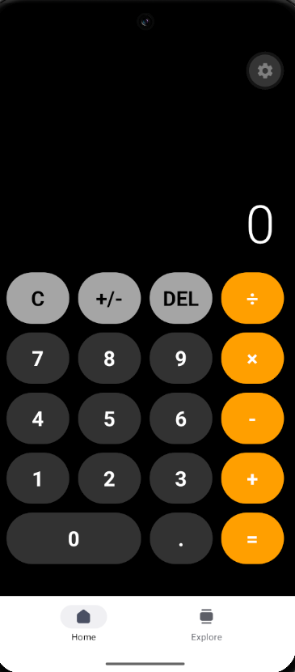

---

# Tarea 11:

## 🎯 1. Objetivo de la tarea
El objetivo de esta actividad es reorganizar la estructura del proyecto utilizando Expo Router para mantener todas las prácticas accesibles desde un índice principal y separar la lógica de negocio de la interfaz de usuario. Para ello, se extraen los estados y funciones matemáticas de la calculadora a un hook personalizado (`useCalculadora.ts`), logrando una pantalla más limpia, modular y fácil de mantener.

---

## 🛠️ 2. Desarrollo y Pasos Seguidos

1. **Creación:** Creación de la carpeta `src/hooks/` con el archivo `useCalculadora.ts`, además de la nueva pantalla `Practica11Screen.tsx` y los archivos de ruta correspondientes dentro de `src/app/` (`practica04.tsx` hasta `practica11.tsx`).
2. **Implementación:** Extraímos todos los estados y operaciones de cálculo hacia el hook personalizado `useCalculadora`, conectándolo en `Practica11Screen.tsx` para dejar únicamente la interfaz visual. Además, configuramos la navegación en `_layout.tsx` mediante `Stack` y transformamos `src/app/index.tsx` en un índice general con enlaces (`Link`) a cada práctica.
3. **Pruebas:** Ejecución en el emulador de Android Studio comprobando que la navegación desde el menú principal abre cada ejercicio correctamente y que la calculadora mantiene todas sus funciones intactas mediante el hook.


## 💻 3. Código Implementado

Para mantener el proyecto escalable y evitar duplicar archivos extensos, se ha estructurado la aplicación siguiendo el patrón de separación entre **rutas**, **pantallas**, **componentes** y **lógica de negocio (hooks)**:

### 📂 Estructura del Proyecto

```
src/
├── app/
│   ├── _layout.tsx             # Configuración de navegación Stack
│   ├── index.tsx               # Menú principal con enlaces (Link)
│   └── practica04..11.tsx      # Rutas dinámicas de cada ejercicio
├── components/
│   └── TeclaCalculadora.tsx    # Botón reutilizable de la calculadora
├── hooks/
│   └── useCalculadora.ts       # Lógica y estados de cálculo extraídos
└── screens/
    └── Practica11Screen.tsx    # Interfaz visual conectada al hook

```

### 🧩 Resumen de Archivos Clave

| Archivo | Rol en la Arquitectura | Responsabilidad Principal |
| :--- | :--- | :--- |
| **`useCalculadora.ts`** | Custom Hook | Gestiona los estados (`actual`, `anterior`, `operacion`) y las operaciones matemáticas sin mezclar lógica con la vista. |
| **`Practica11Screen.tsx`** | Vista / Pantalla | Renderiza el visor y el teclado de la calculadora consumiendo únicamente los datos y funciones que devuelve el hook. |
| **`TeclaCalculadora.tsx`** | Componente UI | Encapsula el diseño táctil (`TouchableOpacity`) y los estilos de cada botón numérico o de operación. |
| **`_layout.tsx` e `index.tsx`** | Navegación (Expo Router) | Configuran la pila de pantallas (`Stack`) y el índice interactivo para acceder a todas las prácticas anteriores. |


## 📸 4. Resultado (Capturas de pantalla)

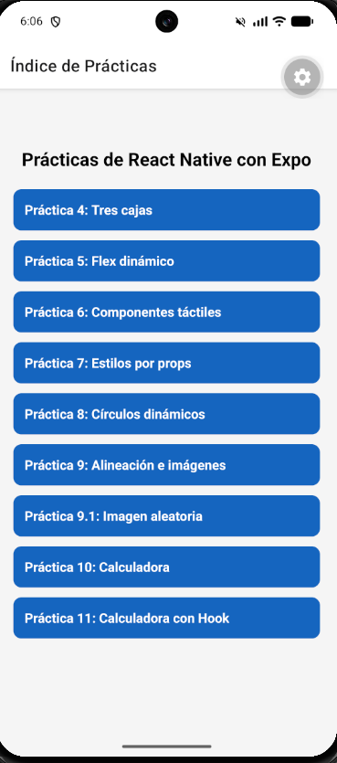

---

# Tarea 12:

## 🎯 1. Objetivo de la tarea
El objetivo de esta actividad es aprender a utilizar diálogos nativos de confirmación mediante **`Alert.alert()`** en React Native para interactuar con el usuario antes de ejecutar una acción.
---

## 🛠️ 2. Desarrollo y Pasos Seguidos

1. **Creación:** Creación de la pantalla `Practica12Screen.tsx` protegida con `SafeAreaView` y su correspondiente ruta `practica12.tsx` dentro de `src/app/`, añadiendo el acceso en el índice principal (`index.tsx`) y en la pila de navegación (`_layout.tsx`).
2. **Implementación:** Definimos una lista de colores con su nombre y código hexadecimal, gestionamos el color activo mediante `useState` y programamos un botón táctil (`TouchableOpacity`) que elige un color aleatorio con `Math.random()` y lanza `Alert.alert()` con las opciones de cancelar o aceptar para actualizar el fondo.
3. **Pruebas:** Ejecución en el emulador de Android Studio verificando que al pulsar «Cancelar» se conserva el color de fondo anterior y al pulsar «Aceptar» se aplica el nuevo color propuesto.

---

## 💻 3. Código Implementado

Para esta práctica se ha ampliado la estructura del proyecto integrando la nueva pantalla dentro del sistema de rutas existente:

### 📂 Archivos Creados y Actualizados
* **`src/screens/Practica12Screen.tsx`:** Pantalla principal con la lógica de selección aleatoria de colores, el diálogo de confirmación `Alert.alert()` y la tarjeta de interfaz dinámica.
* **`src/app/practica12.tsx`:** Archivo de ruta de Expo Router que exporta la pantalla hacia la navegación.
* **`src/app/_layout.tsx` e `index.tsx`:** Actualización del menú principal y de la pila `Stack` para permitir el acceso directo a la Práctica 12.

## 📸 4. Resultado (Capturas de pantalla)

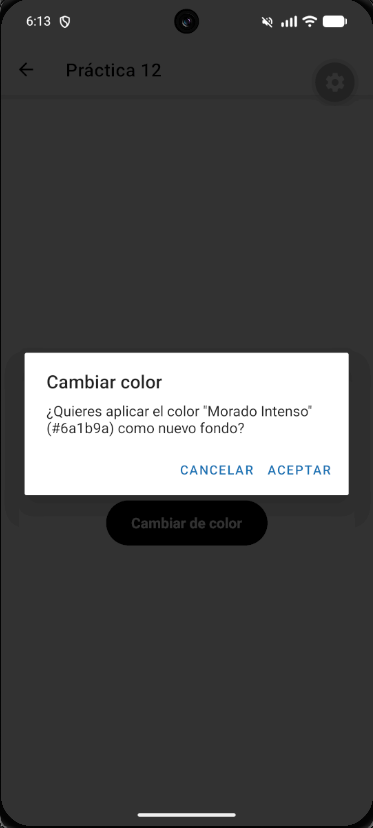
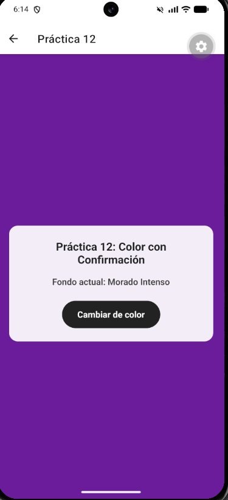

---

# Tarea 13:

## 🎯 1. Objetivo de la tarea
El objetivo de esta actividad es implementar una ventana modal multiplataforma mediante los componentes **`Modal`** y **`TextInput`** para solicitar texto al usuario tanto en Android como en iOS (evitando la dependencia de `Alert.prompt()`). Además, se valida mediante expresiones regulares y listas de nombres CSS que el color introducido sea válido antes de actualizar el estado del fondo de la pantalla.

---

## 🛠️ 2. Desarrollo y Pasos Seguidos

1. **Creación:** Creación de la pantalla `Practica13Screen.tsx` protegida con `SafeAreaView` y su archivo de ruta `practica13.tsx` dentro de `src/app/`, registrando el acceso correspondiente en `_layout.tsx` y en el índice general (`index.tsx`).
2. **Implementación:** Programamos un diálogo emergente transparente (`Modal`) con un campo controlado `TextInput` y botones personalizados para cancelar o aceptar. Antes de aplicar el cambio, validamos con expresiones regulares y una lista de nombres CSS que el texto sea un color válido, mostrando una alerta si es incorrecto.
3. **Pruebas:** Ejecución en el emulador de Android Studio comprobando que al cancelar se conserva el fondo anterior, que los textos no válidos son rechazados y que al aceptar un nombre CSS o código hexadecimal válido se actualiza el fondo al instante.

---

## 💻 3. Código Implementado

Para esta práctica se ha ampliado el proyecto siguiendo la arquitectura modular establecida:

### 📂 Archivos Creados y Actualizados
* **`src/screens/Practica13Screen.tsx`:** Pantalla principal que gestiona el estado de visibilidad del `Modal`, la captura de texto con `TextInput`, la validación de formatos de color (CSS y HEX) y la actualización del fondo.
* **`src/app/practica13.tsx`:** Ruta de Expo Router que expone la pantalla en la navegación.
* **`src/app/_layout.tsx` e `index.tsx`:** Registro de la nueva ruta en la pila `Stack` y adición del enlace en el menú principal.


## 📸 4. Resultado (Capturas de pantalla)

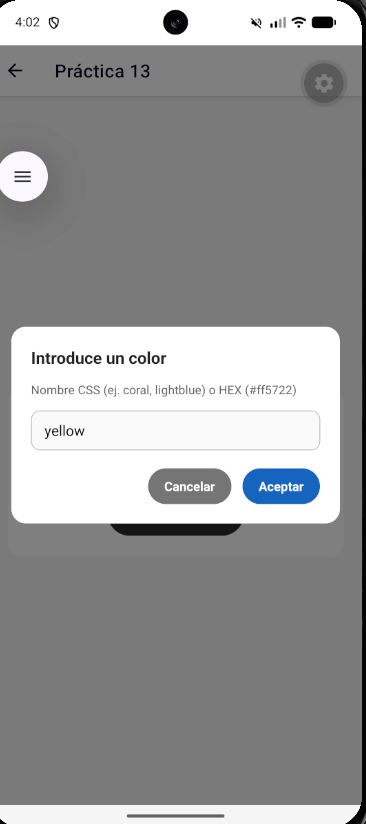
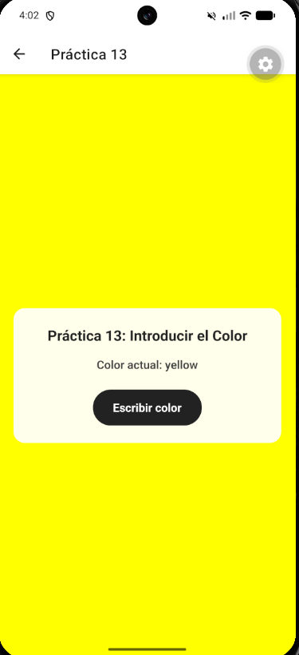
  
---

# Tarea 14:

## 🎯 1. Objetivo de la tarea
El objetivo de esta actividad es aprender a utilizar el componente booleano **`Switch`** en React Native para gestionar estados binarios mediante las propiedades `value` y `onValueChange`, personalizando además el color de su indicador con `thumbColor`.

---

## 🛠️ 2. Desarrollo y Pasos Seguidos

1. **Creación:** Creación de la pantalla `Practica14Screen.tsx` protegida con `SafeAreaView` y su ruta `practica14.tsx` dentro de `src/app/`, añadiendo el acceso correspondiente en `_layout.tsx` y en el índice general (`index.tsx`).
2. **Implementación:** Definimos un estado booleano `activo` con `useState`, conectamos un componente `Switch` configurando su `thumbColor` dinámico (`orange` / `brown`) y aplicamos de forma condicional un borde rojo alrededor del contenedor principal (`activo && styles.bordeActivo`) junto con un indicador textual del estado.
3. **Pruebas:** Ejecución en el emulador de Android Studio comprobando que al activar el interruptor el indicador cambia a naranja y aparece el borde rojo en la pantalla, y al desactivarlo vuelve a marrón eliminando el borde.

---

## 💻 3. Código Implementado

Para esta práctica se ha ampliado el proyecto siguiendo la estructura modular establecida:

### 📂 Archivos Creados y Actualizados
* **`src/screens/Practica14Screen.tsx`:** Pantalla principal que gestiona el estado booleano, la configuración visual del `Switch` y la aplicación condicional del borde rojo.
* **`src/app/practica14.tsx`:** Ruta de Expo Router que expone la pantalla en la navegación.
* **`src/app/_layout.tsx` e `index.tsx`:** Registro de la nueva ruta en la pila `Stack` y adición del enlace en el menú principal.

## 📸 4. Resultado (Capturas de pantalla)

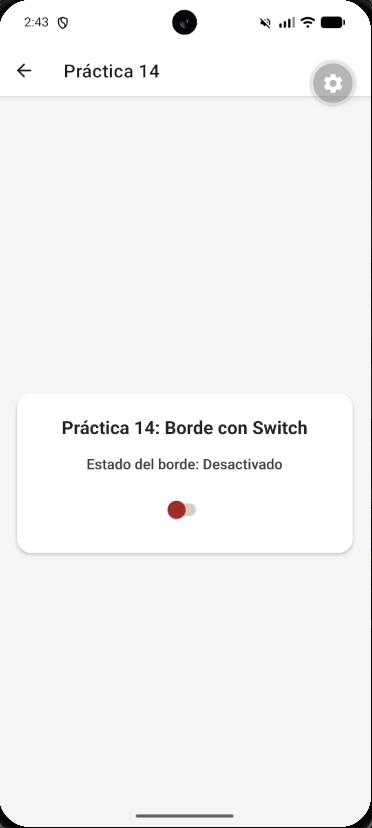
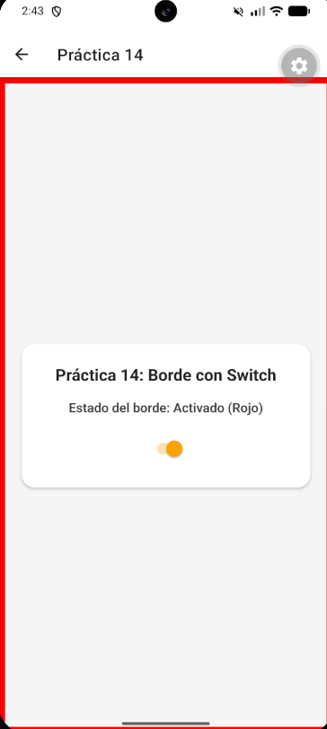

---


