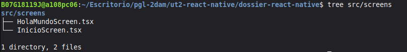
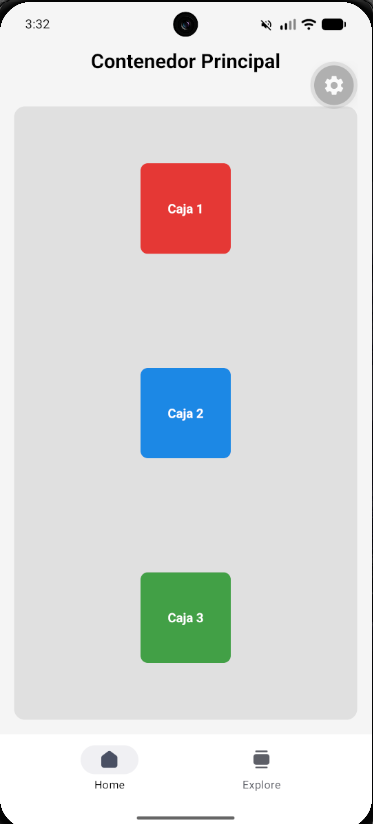

#  Tarea 1:

* **Módulo:** Programación Multimedia y Dispositivos Móviles (PGL - 2º DAM)
* **Unidad:** UT2 - React Native
* **Alumno/a:** [Jorge Hernández Pérez]
* **Fecha:** 12/11/2026

---

## 🎯 1. Objetivo de la tarea
Crear un "hola mundo" con expo para despues usar un emulador de un telefono móvil y asi representar en la pantalla nuestro mensaje

---

## 🛠️ 2. Desarrollo y Pasos Seguidos

1. **Creación / Configuración:** Creación del proyecto en la terminal con npx
2. **Implementación:** Sustituimos el código del index.tsx para poder representar el mensaje en su pantalla
3. **Pruebas:** Ejecución en emulador Android / dispositivo físico con Expo Go, logeandonos en expo y configurándolo.

---

## 💻 3. Código Implementado

```jsx
import { StyleSheet, Text, View } from 'react-native';

export default function Index() {
  return (
    <View style={styles.pantalla}>
      <Text>¡Hola mundo! Soy Jorge</Text>
    </View>
  );
}

const styles = StyleSheet.create({
  pantalla: {
    alignItems: 'center',
    backgroundColor: 'lightpink',
    flex: 1,
    justifyContent: 'center',
  },
});
```

---

## 📸 4. Resultado (Capturas de pantalla)


---


#  Tarea 2:


## 🎯 1. Objetivo de la tarea
Creación de dos botones, uno que incremente y otro que descremente, además de cambiar el estilo de los botones y de algunos elementos.

---

## 🛠️ 2. Desarrollo y Pasos Seguidos

1. **Edición:** Edición de la pantalla principal de la aplciación para que muestre lo que deseemos.
2. **Implementación:** Implementamos funciones que hagan las funciones que buscamos para completar la actividad.
3. **Pruebas:** Ejecución en emulador Android

---

## 💻 3. Código Implementado

```jsx
import { useState } from 'react';
import { Button, StyleSheet, Text, View } from 'react-native';

export default function ContadorScreen() {
  const [contador, setContador] = useState(0);

  return (
    <View style={styles.contenedorPrincipal}>
      <View style={styles.caja}>
        <Text style={styles.texto}>Contador: {contador}</Text>
        
        <View style={styles.filaBotones}>
          <Button 
            title="Decrementar" 
            color="#d9534f"
            onPress={() => setContador(n => n - 1)} 
          />
          <Button 
            title="Incrementar" 
            color="#5cb85c"
            onPress={() => setContador(n => n + 1)} 
          />
        </View>
      </View>
    </View>
  );
}

const styles = StyleSheet.create({
  contenedorPrincipal: {
    flex: 1,
    justifyContent: 'center',
    alignItems: 'center',
    backgroundColor: '#f5f5f5',
  },
  caja: {
    alignItems: 'center',
    backgroundColor: '#e3f2fd', 
    borderColor: '#1976d2',    
    borderWidth: 2,
    borderRadius: 15,         
    padding: 25,
    gap: 15,
  },
  texto: {
    fontSize: 22,
    fontWeight: 'bold',
  },
  filaBotones: {
    flexDirection: 'row',      
    gap: 12,                   
  },
});


```
---

## 📸 4. Resultado (Capturas de pantalla)


---

#  Tarea 3:


## 🎯 1. Objetivo de la tarea
Separar las últimas dos actividades en pantallas diferentes dentro de la carpeta src/screens

---

## 🛠️ 2. Desarrollo y Pasos Seguidos

1. **Creación / Configuración:** Creación de la carpeta screens dentro de src, y de los archivos HolaMundo.tsx e InicioScreen.tsx.
2. **Implementación:**Implementamos el código de cada pantalla dentro de su respectivo archivo

---


## 📸 3. Resultado (Capturas de pantalla)



---

#  Tarea 4:


## 🎯 1. Objetivo de la tarea
Comprender el funcionamiento básico de Flexbox en React Native y aprender a crear componentes reutilizables.

---

## 🛠️ 2. Desarrollo y Pasos Seguidos

1. **Creación :** Creación del componente caja.tsx para no tener que repetir código, además de la pantalla PincipalScreen.tsx
2. **Implementación:** Creamos el código para ambos arvhivos y dentro de index.tsx actualizamos para que se vea la patalla nueva.
3. **Pruebas:** Ejecución en emulador Android
---

## 💻 3. Código Implementado


```jsx
import { StyleSheet, Text, View } from 'react-native';
import Caja from '../components/Caja';

export default function PrincipalScreen() {
  return (
    <View style={styles.contenedor}>
      <Text style={styles.titulo}>Contenedor Principal</Text>
      
      <View style={styles.escenario}>
        <Caja nombre="Caja 1" bg="#e53935" />
        <Caja nombre="Caja 2" bg="#1e88e5" />
        <Caja nombre="Caja 3" bg="#43a047" />
      </View>
    </View>
  );
}

const styles = StyleSheet.create({
  contenedor: {
    flex: 1,
    paddingTop: 50,
    backgroundColor: '#f5f5f5',
  },
  titulo: {
    fontSize: 22,
    fontWeight: 'bold',
    textAlign: 'center',
    marginBottom: 20,
  },
  escenario: {
    flex: 1,
    justifyContent: 'space-around', 
    alignItems: 'center',          
    backgroundColor: '#e0e0e0',
    margin: 16,
    borderRadius: 12,
  },
});

```

```jsx
import { StyleSheet, Text, View } from 'react-native';

type Props = { 
  nombre: string; 
  bg?: string; 
};

export default function Caja({ nombre, bg = 'green' }: Props) {
  return (
    <View style={[styles.caja, { backgroundColor: bg }]}>
      <Text style={styles.texto}>{nombre}</Text>
    </View>
  );
}

const styles = StyleSheet.create({
  caja: { 
    height: 100, 
    width: 100, 
    justifyContent: 'center', 
    alignItems: 'center',
    borderRadius: 8,
  },
  texto: {
    color: 'white',
    fontWeight: 'bold',
  },
});

```

---

## 📸 4. Resultado (Capturas de pantalla)



---

#  Tarea 5:


## 🎯 1. Objetivo de la tarea
El objetivo de esta actividad es comprender cómo la propiedad flex reparte dinámicamente el espacio disponible entre elementos hermanos dentro de un contenedor en React Native.

---

## 🛠️ 2. Desarrollo y Pasos Seguidos

1. **Creación:** Creación del nuevo componente `CajaFlex.tsx` (una variante sin altura fija para que `flex` pueda actuar libremente) y de la pantalla `Practica5Screen.tsx` para mantener el ejercicio independiente y consultable.
2. **Implementación:** Programamos la lógica de estado individual (`useState`) con los botones para incrementar y decrementar `valorFlex` (limitado a un mínimo de `0` con `Math.max`), montamos las tres cajas en `Practica5Screen.tsx` y actualizamos `index.tsx` para mostrar esta pantalla.
3. **Pruebas:** Ejecución en el emulador de Android Studio comprobando cómo se reorganiza y reparte proporcionalmente el espacio entre las tres cajas al pulsar los botones.

---

## 💻 3. Código Implementado


```jsx
import { StyleSheet, Text, View } from 'react-native';
import CajaFlex from '../components/CajaFlex';

export default function Practica5Screen() {
  return (
    <View style={styles.contenedor}>
      <Text style={styles.titulo}>Práctica 5: Reparto con Flex</Text>

      <View style={styles.escenario}>
        <CajaFlex nombre="Caja 1" bg="#e53935" />
        <CajaFlex nombre="Caja 2" bg="#1e88e5" />
        <CajaFlex nombre="Caja 3" bg="#43a047" />
      </View>
    </View>
  );
}

const styles = StyleSheet.create({
  contenedor: {
    flex: 1,
    paddingTop: 50,
    backgroundColor: '#f5f5f5',
  },
  titulo: {
    fontSize: 22,
    fontWeight: 'bold',
    textAlign: 'center',
    marginBottom: 15,
  },
  escenario: {
    flex: 1,
    alignItems: 'center',
    backgroundColor: '#e0e0e0',
    margin: 16,
    padding: 10,
    borderRadius: 12,
  },
});


```

```jsx
import { useState } from 'react';
import { Button, StyleSheet, Text, View } from 'react-native';

type Props = {
  nombre: string;
  bg?: string;
};

export default function CajaFlex({ nombre, bg = '#43a047' }: Props) {
  const [valorFlex, setValorFlex] = useState(1);

  return (
    <View style={[styles.caja, { backgroundColor: bg, flex: valorFlex }]}>
      <Text style={styles.texto}>
        {nombre} — flex: {valorFlex}
      </Text>

      <View style={styles.filaBotones}>
        <Button
          title="-"
          color="#212121"
          onPress={() => setValorFlex(n => Math.max(0, n - 1))}
        />
        <Button
          title="+"
          color="#212121"
          onPress={() => setValorFlex(n => n + 1)}
        />
      </View>
    </View>
  );
}

const styles = StyleSheet.create({
  caja: {
    width: '90%',
    minHeight: 70,
    justifyContent: 'center',
    alignItems: 'center',
    borderRadius: 10,
    padding: 8,
    marginVertical: 4,
  },
  texto: {
    color: 'white',
    fontWeight: 'bold',
    fontSize: 16,
    marginBottom: 6,
  },
  filaBotones: {
    flexDirection: 'row',
    gap: 15,
  },
});


```

---

## 📸 4. Resultado (Capturas de pantalla)


---

#  Tarea 6:


## 🎯 1. Objetivo de la tarea
El objetivo de esta actividad es comprender las diferencias entre los componentes táctiles TouchableOpacity y TouchableHighlight en React Native frente a los botones nativos tradicionales

---
## 🛠️ 2. Desarrollo y Pasos Seguidos

1. **Creación:** Creación del nuevo componente `CajaTouchable.tsx` (sustituyendo los botones nativos por contenedores táctiles personalizados) y de la pantalla `Practica6Screen.tsx` para conservar las prácticas anteriores consultables.
2. **Implementación:** Programamos el botón de decremento con `TouchableOpacity` (reduciendo su opacidad al pulsar) y el de incremento con `TouchableHighlight` (aplicando `underlayColor` y disparando una ventana emergente con `Alert.alert`), montamos las tres cajas en `Practica6Screen.tsx` y actualizamos `index.tsx` para mostrar esta pantalla.
3. **Pruebas:** Ejecución en el emulador de Android Studio verificando el efecto visual de cada componente táctil, el lanzamiento de la alerta al sumar y el reparto proporcional de espacio en pantalla.

---

## 💻 3. Código Implementado


```jsx

import { StyleSheet, Text, View } from 'react-native';
import CajaTouchable from '../components/CajaTouchable';

export default function Practica6Screen() {
  return (
    <View style={styles.contenedor}>
      <Text style={styles.titulo}>Práctica 6: Componentes Táctiles</Text>

      <View style={styles.escenario}>
        <CajaTouchable nombre="Caja 1" bg="#e53935" />
        <CajaTouchable nombre="Caja 2" bg="#1e88e5" />
        <CajaTouchable nombre="Caja 3" bg="#43a047" />
      </View>
    </View>
  );
}

const styles = StyleSheet.create({
  contenedor: {
    flex: 1,
    paddingTop: 50,
    backgroundColor: '#f5f5f5',
  },
  titulo: {
    fontSize: 22,
    fontWeight: 'bold',
    textAlign: 'center',
    marginBottom: 15,
  },
  escenario: {
    flex: 1,
    alignItems: 'center',
    backgroundColor: '#e0e0e0',
    margin: 16,
    padding: 10,
    borderRadius: 12,
  },
});


```

```jsx

import { useState } from 'react';
import { Alert, StyleSheet, Text, TouchableHighlight, TouchableOpacity, View } from 'react-native';

type Props = {
  nombre: string;
  bg?: string;
};

export default function CajaTouchable({ nombre, bg = '#43a047' }: Props) {
  const [valorFlex, setValorFlex] = useState(1);

  const manejarIncremento = () => {
    setValorFlex(n => n + 1);
    Alert.alert('Flex aumentado', `${nombre} ahora tiene flex: ${valorFlex + 1}`);
  };

  return (
    <View style={[styles.caja, { backgroundColor: bg, flex: valorFlex }]}>
      <Text style={styles.texto}>
        {nombre} — flex: {valorFlex}
      </Text>

      <View style={styles.filaBotones}>
        <TouchableOpacity
          style={styles.botonRestar}
          activeOpacity={0.6}
          onPress={() => setValorFlex(n => Math.max(0, n - 1))}
        >
          <Text style={styles.textoBoton}>-1 Flex</Text>
        </TouchableOpacity>

        <TouchableHighlight
          style={styles.botonSumar}
          underlayColor="#1b5e20"
          onPress={manejarIncremento}
        >
          <Text style={styles.textoBoton}>+1 Flex</Text>
        </TouchableHighlight>
      </View>
    </View>
  );
}

const styles = StyleSheet.create({
  caja: {
    width: '90%',
    minHeight: 80,
    justifyContent: 'center',
    alignItems: 'center',
    borderRadius: 12,
    padding: 10,
    marginVertical: 4,
  },
  texto: {
    color: 'white',
    fontWeight: 'bold',
    fontSize: 16,
    marginBottom: 8,
  },
  filaBotones: {
    flexDirection: 'row',
    gap: 15,
  },
  botonRestar: {
    backgroundColor: '#212121',
    paddingVertical: 8,
    paddingHorizontal: 16,
    borderRadius: 20,
    borderWidth: 1,
    borderColor: 'white',
  },
  botonSumar: {
    backgroundColor: '#004d40',
    paddingVertical: 8,
    paddingHorizontal: 16,
    borderRadius: 20,
    borderWidth: 1,
    borderColor: 'white',
  },
  textoBoton: {
    color: 'white',
    fontWeight: 'bold',
    fontSize: 14,
  },
});


```

---

## 📸 4. Resultado (Capturas de pantalla)


---
