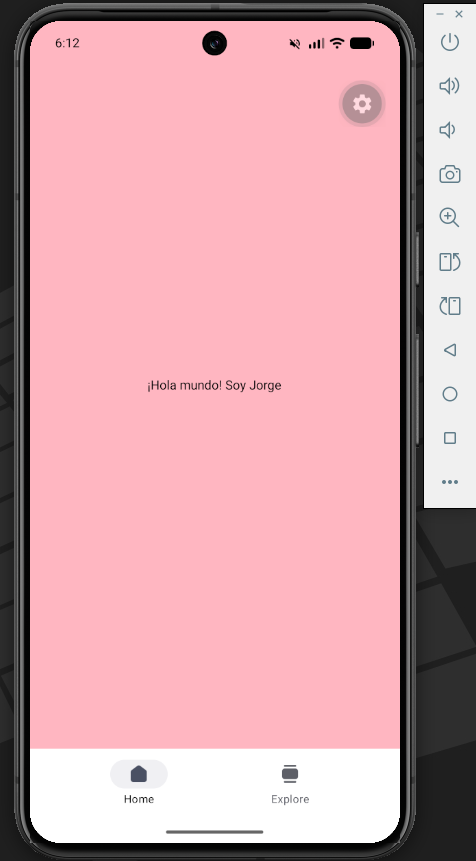

#  Tarea 1:

* **Módulo:** Programación Multimedia y Dispositivos Móviles (PGL - 2º DAM)
* **Unidad:** UT2 - React Native
* **Alumno/a:** [Jorge Hernández Pérez]
* **Fecha:** 12/11/2026

---

## 🎯 1. Objetivo de la tarea
Crear un "hola mundo" con expo para despues usar un emulador de un telefono móvil y asi representar en la pantalla nuestro mensaje

---

## 🛠️ 2. Desarrollo y Pasos Seguidos

1. **Creación / Configuración:** Creación del proyecto en la terminal con npx
2. **Implementación:** Sustituimos el código del index.tsx para poder representar el mensaje en su pantalla
3. **Pruebas:** Ejecución en emulador Android / dispositivo físico con Expo Go, logeandonos en expo y configurándolo.

---

## 💻 3. Código Implementado

```jsx
import { StyleSheet, Text, View } from 'react-native';

export default function Index() {
  return (
    <View style={styles.pantalla}>
      <Text>¡Hola mundo! Soy Jorge</Text>
    </View>
  );
}

const styles = StyleSheet.create({
  pantalla: {
    alignItems: 'center',
    backgroundColor: 'lightpink',
    flex: 1,
    justifyContent: 'center',
  },
});
```

---

## 📸 4. Resultado (Capturas de pantalla)



---


#  Tarea 2:


## 🎯 1. Objetivo de la tarea
Creación de dos botones, uno que incremente y otro que descremente, además de cambiar el estilo de los botones y de algunos elementos.

---

## 🛠️ 2. Desarrollo y Pasos Seguidos

1. **Edición:** Edición de la pantalla principal de la aplciación para que muestre lo que deseemos.
2. **Implementación:** Implementamos funciones que hagan las funciones que buscamos para completar la actividad.
3. **Pruebas:** Ejecución en emulador Android / dispositivo físico con Expo Go, logeandonos en expo y configurándolo.

---

## 💻 3. Código Implementado

```jsx
import { useState } from 'react';
import { Button, StyleSheet, Text, View } from 'react-native';

export default function ContadorScreen() {
  const [contador, setContador] = useState(0);

  return (
    <View style={styles.contenedorPrincipal}>
      <View style={styles.caja}>
        <Text style={styles.texto}>Contador: {contador}</Text>
        
        <View style={styles.filaBotones}>
          <Button 
            title="Decrementar" 
            color="#d9534f"
            onPress={() => setContador(n => n - 1)} 
          />
          <Button 
            title="Incrementar" 
            color="#5cb85c"
            onPress={() => setContador(n => n + 1)} 
          />
        </View>
      </View>
    </View>
  );
}

const styles = StyleSheet.create({
  contenedorPrincipal: {
    flex: 1,
    justifyContent: 'center',
    alignItems: 'center',
    backgroundColor: '#f5f5f5',
  },
  caja: {
    alignItems: 'center',
    backgroundColor: '#e3f2fd', 
    borderColor: '#1976d2',    
    borderWidth: 2,
    borderRadius: 15,         
    padding: 25,
    gap: 15,
  },
  texto: {
    fontSize: 22,
    fontWeight: 'bold',
  },
  filaBotones: {
    flexDirection: 'row',      
    gap: 12,                   
  },
});


```
---

## 📸 4. Resultado (Capturas de pantalla)


---

